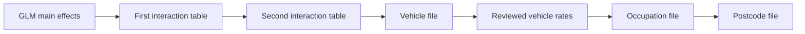

# Examples and workflows

These walkthroughs show how to build and review models interactively: fit main
effects, check what they miss, try an interaction, add a specialist model,
amend rates and export the result. Each modelling action is shown explicitly.

**Start with [Building a pricing model](pricing_walkthrough.md)** for a GLM and
two interaction tables on French motor data. Use the
[Workbench walkthrough](workbench_walkthrough.md) for the same decisions in
the browser.

| What you want to do | Worked example |
| --- | --- |
| Fit a small GLM, inspect A/E and find missing factors | [Building a pricing model](pricing_walkthrough.md#fit-the-first-glm) |
| Control automatic bins or supply your own numeric cuts | [Choose the bins](pricing_walkthrough.md#set-how-numeric-variables-are-binned) |
| Add two interaction tables in order | [Fit and review interactions](pricing_walkthrough.md#fit-the-first-interaction) |
| Set up shared roles and different variables for each GUI model | [Workbench walkthrough](workbench_walkthrough.md) |
| Build vehicle, occupation and postcode files after a GLM and its interactions | [Stacking models and building rating files](stacked_models.md) |
| Score every entry in a catalogue, including codes with no training rows | [Full-file scoring and exports](stacked_models.md#export-reopen-and-score-an-unseen-catalogue-code) |
| Fit CatBoost alone, GLM then CatBoost, or CatBoost then GLM | [Other model workflows](model_variations.md) |
| Model pure premium, paid severity or claim occurrence | [Model families](model_families.md) |
| Choose Optuna trials, a tuning-time limit or manual CatBoost settings | [CatBoost fitting controls](model_variations.md#standalone-catboost-with-a-trial-budget) |
| Change bands, keep earlier models and compare candidates | [Revised numeric bands](pricing_walkthrough.md#fit-the-first-glm) |
| Understand, save and run `Project.from_dict` recipes | [Save, edit and run a model recipe](project_workflow.md) |
| Take a fitted GUI workflow into Python, or score without refitting | [Project and scorer exports](project_workflow.md#export-the-accepted-setup-and-the-fitted-scorer) |
| Give an LLM the package's current conventions | [Usage guide](../docs/LLM_USAGE_GUIDE.md) |

The French motor pricing walkthrough covers the published v0.472 interactive
API. The current staged GUI, mixed-model API and workflow exports described in
the other guides are unreleased. They have been checked against the current
implementation; installing v0.472 does not add those features. See
[release and implementation status](../docs/HANDOVER.md) before assuming a
published version contains them.

## Which API should I use?

| You are working on… | Use… |
| --- | --- |
| The next modelling decision, with charts and named fitted candidates | `PricingSession` and `PricingModel` |
| A stored setup, workbench project JSON or generated fitting workflow | `Project`, then `prepare` and `run_model` for a named fitting recipe |
| An approved set of fitted rates | A saved fitted model or Python scorer |

`Project.from_dict` reads settings. It does not fit a model. A project recipe
and its fitted scorer are different files: keep both if you want to continue
modelling and retain the approved prices.

## Read the model chain

For the rating-file example, the fitting sequence is:

The first two interaction tables belong to the GLM in the GUI. You add them
after inspecting the fitted main effects; they are not separate model types
in project planning. Each later fit uses the **complete preceding accepted
score** as its offset. For example, occupation uses the GLM, both interaction
tables and the reviewed vehicle file.

A/E for each named checkpoint uses the original response and the combined
prediction through that point. A vehicle multiplier by itself is a component
rate, not the complete predicted frequency.

## How to work through the examples

Run the Python blocks on a page in order in the same notebook or session.
Inspect the displayed tables and plots before choosing the next change. The
named candidates remain available; continuing from one does not overwrite the
others. Commented alternatives show a choice you can try separately.

The examples use training data for fitting, residual searches and tuning.
`cv=True` evaluates held-back training folds. Holdout results are shown only
in the explicit validation steps. An example's selected factors and rate caps
demonstrate the controls; they are not recommendations for another portfolio.

For GUI actions, use the current labels and order in the
[Workbench walkthrough](workbench_walkthrough.md). It covers starting a new
plan, revising an existing fit, adding a model and returning to diagnostics.

For more detail on accepted model ownership and saved versions, see
[Model flow](../docs/MODEL_FLOW.md). That reference supports the walkthroughs;
you do not need to read it before fitting the first GLM.
