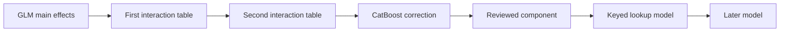

# Examples and workflows

Start with [Building a pricing model](pricing_walkthrough.md), a worked insurance
example: fit a small GLM, check A/E, add missing factors and interactions, amend
rates and export to Excel. For the browser version, use the
[Workbench walkthrough](workbench_walkthrough.md).

The examples use insurance data and names, but the model-building actions are
general. Use the guides below for other model orders, keyed lookup data and
scoring new data.

| What you want to do | Worked example |
| --- | --- |
| Fit a small GLM, inspect A/E and find missing factors | [Building a pricing model](pricing_walkthrough.md#fit-the-first-glm) |
| Control automatic bins or supply your own numeric cuts | [Choose the bins](pricing_walkthrough.md#set-how-numeric-variables-are-binned) |
| Compare numeric bands with smooth curves and control their tails | [Numeric curves](numeric_curves.md) |
| Add two interaction tables in order | [Fit and review interactions](pricing_walkthrough.md#fit-the-first-interaction) |
| Set up shared roles and different variables for each GUI model | [Workbench walkthrough](workbench_walkthrough.md) |
| Build chained GLM, interaction and keyed lookup models | [Chained lookup example](stacked_models.md) |
| Score every entry in keyed lookup data, including keys with no training rows | [Full-file scoring and exports](stacked_models.md#export-reopen-and-score-an-unseen-catalogue-code) |
| Score another dataset, one model component or refreshed lookup data | [Score new data and export rating files](new_data_scoring.md) |
| Fit CatBoost alone, GLM then CatBoost, or CatBoost then GLM | [Other model workflows](model_variations.md) |
| Model count, positive or binary outcomes | [Model families](model_families.md) |
| Choose Optuna trials, a tuning-time limit or manual CatBoost settings | [CatBoost fitting controls](model_variations.md#standalone-catboost-with-a-trial-budget) |
| Change bands, keep earlier models and compare candidates | [Revised numeric bands](pricing_walkthrough.md#try-revised-bands) |
| Understand, save and run `Project.from_dict` recipes | [Save, edit and run a model recipe](project_workflow.md) |
| Take a fitted GUI workflow into Python, or score without refitting | [Project and scorer exports](project_workflow.md#export-the-accepted-setup-and-the-fitted-scorer) |
| Give an LLM the package's current conventions | [Usage guide](../docs/LLM_USAGE_GUIDE.md) |

## Which API should I use?

| What you want to do | Use |
| --- | --- |
| Build and review models one step at a time | `PricingSession` sets up the data; each fit returns a `PricingModel` to inspect, amend or build on. |
| Run or edit the workbench's saved settings in Python | `Project` reads the setup; `prepare` prepares the data and `run_model` fits a named model. |
| Apply fitted rates to data | Load the saved model or use its exported Python scorer. |

Save both the project setup and fitted model if you want to return to the
modelling work and keep the existing rates.

## Read the model chain

One possible sequence is:

In the workbench, add interaction tables inside the GLM after reviewing its
main effects. Each later fit uses the combined prediction from everything
before it as its offset. Each later model therefore corrects the GLM, accepted
interaction tables and every earlier component.

A/E after a model checks the combined prediction against the observed outcome.
A downstream correction on its own may be a multiplier to apply to the preceding
score, rather than a complete prediction.

## How to work through the examples

Run a page's blocks in order in the same notebook or session. Inspect each fit
before deciding what to change. Named models remain available for comparison,
and commented blocks show alternatives you can try.

Use training data for model development and the explicit holdout steps for
the final check. `cv=True` compares models on held-back training folds.
